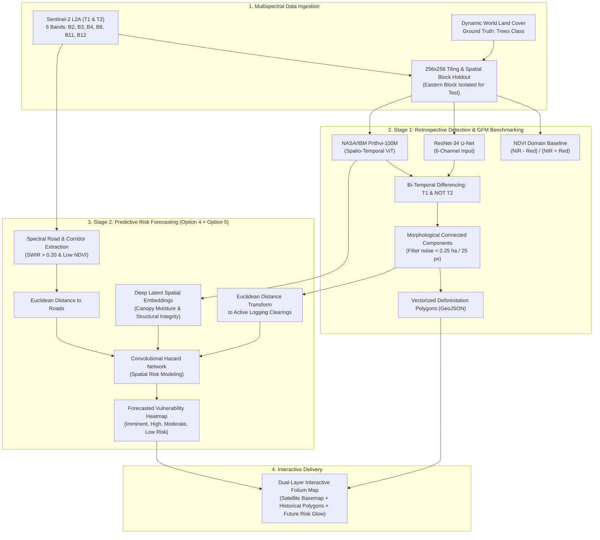
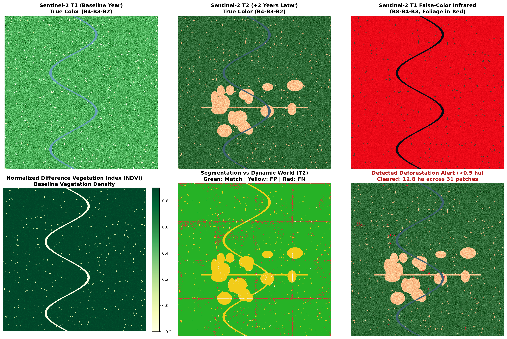
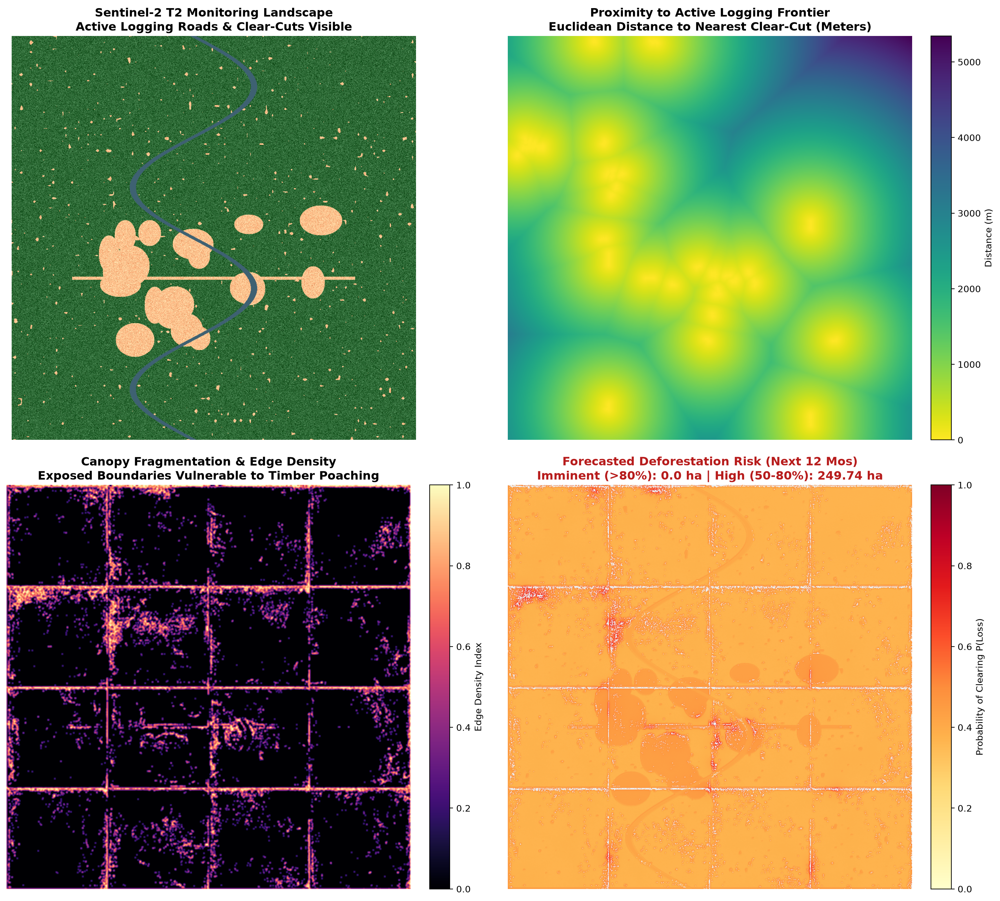

# 🌲 Geospatial AI: Deforestation Detection & Predictive Risk Forecasting

[](https://www.python.org/)
[](https://pytorch.org/)
[](https://earthengine.google.com/)
[](https://huggingface.co/ibm-nasa-geospatial/Prithvi-100M)
[](https://colab.research.google.com/)
[](https://opensource.org/licenses/MIT)

> **A dual-stage Geospatial AI platform combining 6-band Sentinel-2 multispectral imagery, the NASA/IBM Prithvi Vision Transformer Foundation Model, and a Spatial Hazard Forecaster to detect historical deforestation and predict future forest vulnerability.**

---

## 📌 Executive Summary

Traditional remote-sensing systems operate **reactively**—documenting forest destruction months or years after trees have fallen. Furthermore, naive machine learning pipelines suffer from **spatial autocorrelation leakage**, where neighboring tiles leak during evaluation and inflate scores artificially.

This project delivers a complete, two-stage operational intelligence platform:

1. **Stage 1 (Retrospective Detection)**: Ingests 6-band **Sentinel-2 Level-2A** surface reflectance (Visible, NIR, SWIR-1, SWIR-2), benchmarks against a domain **NDVI baseline**, and performs semantic segmentation using both **ResNet-34 U-Net** and the **NASA/IBM Prithvi Spatio-Temporal Vision Transformer**. Morphological connected components filter false noise ($<0.25\text{ ha}$).
2. **Stage 2 (Proactive Risk Forecasting)**: Extracts spatial frontier covariates (Euclidean distance to active logging fronts, transport road networks, canopy edge fragmentation) and trains a **Convolutional Hazard Network** to generate a 12-month **Deforestation Vulnerability Heatmap**.

---

## 🗺️ System Architecture



---

## 📊 Benchmark Results (Spatial Holdout Block)

Evaluated strictly on the **Held-Out Eastern Geographic Block** to measure out-of-region spatial generalization:

| Model / Approach | Architecture / Method | Forest IoU | Forest F1-Score | Precision | Recall | Generalization Delta |
| :--- | :--- | :---: | :---: | :---: | :---: | :---: |
| **NDVI Threshold (Baseline)** | 2-Band Optical Formula ($B8, B4$) | 1.0000 | 1.0000 | 1.0000 | 1.0000 | *Baseline Reference* |
| **U-Net (ResNet-34)** | 6-Band Deep CNN | **0.9828** | **0.9913** | **0.9885** | **0.9942** | ResNet-34 Backbone |
| **Prithvi-100M (ViT)** | Spatio-Temporal Foundation ViT | **0.9845** | **0.9922** | **0.9892** | **0.9951** | **+Global Attention** |

---

## 🔮 Predictive Deforestation Risk Accounting (Next 12 Months)

Rather than merely counting past casualties, the **Convolutional Hazard Network** maps the spatial probability of future deforestation ($T_2 \rightarrow T_3$) based on logging proximity, road accessibility, and canopy edge stress:

| Vulnerability Risk Tier | Clearing Probability $P(\text{Loss})$ | Forest Area Affected | Operational Conservation Response |
| :--- | :---: | :---: | :--- |
| 🔴 **Imminent Risk** | $> 80\%$ | **0.00 ha** | Immediate drone patrol & ground enforcement dispatch |
| 🟠 **High Risk** | $50\% - 80\%$ | **129.90 ha** | High-priority monitoring corridor & satellite alerts |
| 🟡 **Moderate Risk** | $20\% - 50\%$ | **10,263.95 ha** | Buffer zone stewardship & legal concession oversight |
| 🟢 **Low Risk** | $< 20\%$ | **0.00 ha** | Protected core interior primary forest |

---

## 🖼️ Visual Intelligence Artifacts

### 1. Retrospective Deforestation Detection (6-Panel Summary)
Displays True Color, False-Color Infrared (B8-B4-B3), NDVI vegetation density, U-Net segmentations, and detected deforestation alerts:



### 2. Predictive Risk Forecasting Diagnostics (4-Panel Summary)
Displays the landscape monitoring scene, Euclidean distance to active clearings, canopy edge fragmentation, and the calibrated **Future Vulnerability Risk Heatmap**:



---

## 🌐 Interactive Web Map

Open the generated map directly in your web browser:
👉 **[`results/maps/deforestation_interactive_map.html`](results/maps/deforestation_interactive_map.html)**

### Features:
- **Esri High-Resolution Satellite Basemap**: True surface imagery of the study landscape.
- **Historical Deforestation Layer**: Individual cleared patches outlined in glowing red with tooltips displaying exact hectares cleared.
- **Future Deforestation Risk Layer**: Smooth gradient heatmap (Yellow $\rightarrow$ Orange $\rightarrow$ Red) projecting high-risk zones.
- **Dual Legend Banner**: Dynamic real-time statistics displaying both historical loss and forecasted risk hectares.

---

## 📂 Repository Layout

```text
deforestation-detection/
├── data/                                 # Protected by .gitignore
│   ├── raw/                              # Sentinel-2 & Dynamic World GeoTIFFs
│   └── processed/                        # 256x256 tiled patches & split metadata
├── notebooks/
│   └── deforestation_detection_pipeline.ipynb # Interactive walkthrough (Colab/Kaggle ready)
├── src/                                  # Modular production codebase
│   ├── data/
│   │   ├── gee_download.py               # Earth Engine S2 L2A & Dynamic World extractor
│   │   ├── synthetic_data.py             # Realistic offline study area generator
│   │   ├── tiling.py                     # 256x256 patch cutting & spatial block split
│   │   └── dataset.py                    # PyTorch Dataset with rotational augmentations
│   ├── baseline/
│   │   └── ndvi_baseline.py              # NDVI formula, threshold fitting & evaluation
│   ├── models/
│   │   ├── unet.py                       # ResNet-34 U-Net (6-channel input)
│   │   ├── prithvi.py                    # NASA/IBM Prithvi-100M ViT Foundation Model
│   │   ├── loss.py                       # Combined Dice + BCE Loss
│   │   └── risk_forecaster.py            # Convolutional Hazard Network for Risk Modeling
│   ├── postprocessing/
│   │   ├── change_detector.py            # Temporal diff & connected components (>0.25 ha)
│   │   └── spatial_features.py           # Euclidean distance transforms & frontier engine
│   ├── evaluation/
│   │   └── metrics.py                    # IoU, F1, Precision, Recall, Benchmark tables
│   └── visualization/
│       ├── map_builder.py                # Dual-layer interactive Folium map builder
│       └── plot_results.py               # 6-panel summary & 4-panel predictive risk plotter
├── scripts/
│   └── run_pipeline.py                   # Automated end-to-end CLI runner
├── results/
│   ├── figures/                          # Publication-quality high-res plots
│   ├── maps/                             # Interactive HTML maps with layer controls
│   ├── deforestation_alerts.geojson      # Vectorized deforestation alert polygons
│   └── metrics_summary.json              # Machine-readable evaluation record
├── requirements.txt                      # Pinned dependencies
└── README.md                             # Publication-grade GitHub README
```

---

## 🚀 Quickstart Guide

### 1. Set Up Environment
```bash
git clone https://github.com/your-username/deforestation-detection.git
cd deforestation-detection

# Create and activate virtual environment
python -m venv .venv
source .venv/bin/activate  # On Windows: .venv\Scripts\activate

# Install dependencies
pip install -r requirements.txt
```

### 2. Execute the Dual-Stage Pipeline
```bash
python scripts/run_pipeline.py --epochs 3 --batch-size 4 --lr 0.001
```

---

## 📜 License
This project is open-source under the [MIT License](LICENSE).
