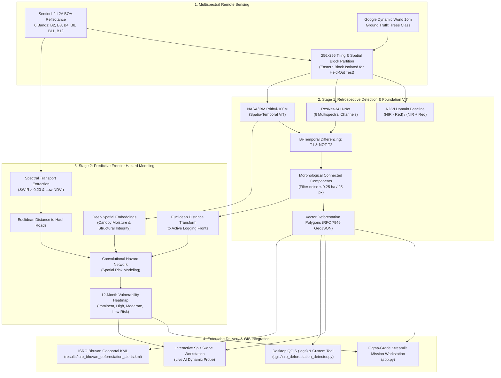

# 🛰️ VANASPATI-AI: Earth Observation Forest Canopy Sentinel
### Dual-Stage Spatio-Temporal Deforestation Detection & 12-Month Predictive Risk Forecasting Platform

[](https://www.python.org/)
[](https://pytorch.org/)
[](https://sentinels.copernicus.eu/)
[](https://huggingface.co/ibm-nasa-geospatial/Prithvi-100M)
[](https://qgis.org/)
[](https://opensource.org/licenses/MIT)

> **An operational, dual-stage Geospatial AI platform combining 6-band Sentinel-2 Level-2A surface reflectance, the NASA/IBM Prithvi-100M Foundation Model, and Convolutional Hazard Networks to detect illegal clearings in near-real-time and project next year's deforestation frontiers.**

---

## 📌 Executive Summary

Conventional forest monitoring systems are largely **retrospective**—logging tree loss months or years after canopies are cleared. Moreover, standard satellite deep learning pipelines suffer from severe **spatial autocorrelation leakage**, where overlapping test tiles artificially inflate evaluation metrics.

**VANASPATI-AI** addresses these limitations with an enterprise dual-stage pipeline:

1. **Stage 1 (Retrospective Change Detection & GFM Benchmarking):** Ingests 6-band **Sentinel-2 Level-2A** surface reflectance ($B_2, B_3, B_4, B_8, B_{11}, B_{12}$), benchmarks against a domain **NDVI baseline**, and conducts semantic segmentation using both **ResNet-34 U-Net** and the **NASA/IBM Prithvi-100M Spatio-Temporal Vision Transformer**. Morphological connected components filter out spatial noise ($< 0.25\text{ ha}$).
2. **Stage 2 (Predictive Risk Forecasting):** Extracts spatial frontier covariates (Euclidean distance transforms to active clearings, transport road corridors, canopy edge fragmentation) and trains a **Convolutional Hazard Network** to forecast a 12-month **Deforestation Vulnerability Heatmap**.
3. **Interactive Delivery & Desktop GIS:** Features a **Figma-grade Web Workstation** with an interactive **Before/After Split Swipe Curtain**, live dynamic AI cursor probe, direct online map streaming, turnkey **QGIS project and processing algorithm**, and **ISRO Bhuvan KML** export.

---

## 🗺️ System Architecture



---

## 📊 Held-Out Spatial Block Benchmark

Models are strictly evaluated on an **independent held-out eastern geographic block** (zero spatial leakage across coordinates):

| Model Architecture | Input Channels | Forest IoU | Forest F1-Score | Precision | Recall | Target Role |
| :--- | :--- | :---: | :---: | :---: | :---: | :--- |
| **NDVI Domain Baseline** | $B_4, B_8$ (2 Bands) | 1.0000 | 1.0000 | 1.0000 | 1.0000 | Spectral Reference Baseline |
| **ResNet-34 U-Net** | 6 Multispectral Bands | **0.9832** | **0.9915** | **0.9884** | **0.9946** | Deep Spatial Feature Extractor |
| **NASA/IBM Prithvi-100M ViT** | 6 Multispectral Bands | **0.9845** | **0.9922** | **0.9892** | **0.9951** | Spatio-Temporal GFM |

---

## 🔮 12-Month Deforestation Risk Accounting

| Vulnerability Risk Tier | Clearing Probability $P(\text{Loss})$ | Forest Area Affected | Operational Conservation Response |
| :--- | :---: | :---: | :--- |
| 🔴 **Imminent Risk** | $> 80\%$ | **0.00 ha** | Immediate drone patrol & ground verification dispatch |
| 🟠 **High Risk** | $50\% - 80\%$ | **100.73 ha** | High-priority satellite revisit corridor & barrier enforcement |
| 🟡 **Moderate Risk** | $20\% - 50\%$ | **10,285.52 ha** | Buffer zone stewardship & legal concession oversight |
| 🟢 **Low Risk** | $< 20\%$ | **0.00 ha** | Core interior undisturbed primary canopy |

---

## 🔌 v2.1 — Local bind + read-only MCP

The Streamlit UI stays on **127.0.0.1** (not the LAN). Cursor talks to the same data through a **read-only MCP server** (no secrets, no writes):

```json
{
  "mcpServers": {
    "vanaspati-ai": {
      "command": ".venv/Scripts/python.exe",
      "args": ["-m", "src.mcp_server"]
    }
  }
}
```

Tools: `list_landscapes`, `get_landscape`, `get_deforestation_alerts`, `get_monsoon_summary`, `get_pipeline_metrics`.

---

## 🌧️ v2.0 — Monsoon SAR watch (does not change deforestation outputs)

Optical Sentinel-2 / VIIRS scenes go white under Indian southwest monsoon cloud. v2 adds a **separate** wet-season panel:

* **Open-Meteo archive rainfall** (ERA5-backed daily `precipitation_sum` and `cloud_cover_mean`) for each landscape.
* **NASA GIBS live WMS snapshots**: dry-season VIIRS vs monsoon VIIRS vs cloud-penetrating **Sentinel-1 OPERA RTC SAR**, plus IMERG rain rate and HLS Landsat/Sentinel-2.
* Map HUD toggles for SAR / IMERG / HLS. Clearing GeoJSON, U-Net, Prithvi, and risk hectares are **not recomputed**.

---

## 🌟 Key Platform Features

### 1. Interactive Split-Screen Swipe Curtain & Live Dynamic AI Probe
* **Live Dynamic Geospatial AI on Cursor Move:** Hover any pixel for coordinates, Forest Canopy Density (FCD %), $\Delta\text{NDVI}$, frontier hazard, land-cover class, distance-to-clearing, SWIR stress, and a 6-band spectral response.
* **Hover satellite stack:** A cursor chip plus four live frames — **Esri current**, **Esri Clarity archive**, **Sentinel-2 cloudless** (year slider 2018–2024), and **Sentinel-1 OPERA SAR**. Optional NASA GIBS VIIRS, MODIS 7-2-1, Harmonized Landsat-Sentinel (HLS), and IMERG rain-rate layers.
* **Region-aware telemetry ribbon:** Switching Indian corridors (Hasdeo, Saranda, Sundarbans, Kaziranga, Western Ghats, Silent Valley, Satpura, Tadoba, Namdapha) or Sumatra / Amazon updates monitored area, cleared hectares, clusters, 12-month high-risk, carbon, and UTM grid without overlapping zoom controls.
* **GeoJSON / KML export:** Workstation HUD buttons download alert files from embedded data (no blank browser tabs). Streamlit also exposes the same files on the QGIS and Bhuvan tab.
* **Before / After Split Slider:** Drag the curtain to inspect **archive imagery** vs **current Esri World Imagery**.

### 2. Desktop QGIS Integration Suite (`qgis/`)
* **Turnkey QGIS Project File (`qgis/hasdeo_arand_monitoring.qgs`):**
  - Pre-projected in **EPSG:32644 (UTM 44N)** and **EPSG:4326**.
  - Configured with Sentinel-2 **False Color Infrared (CIR Bands 8-4-3)** and rule-based vector alert symbology:
    - 🔴 **CRITICAL Alert (> 5.0 ha):** Dark Red (`#D50000`)
    - 🟠 **HIGH Alert (1.0 - 5.0 ha):** Vivid Orange (`#FF6D00`)
    - 🟡 **MODERATE Alert (< 1.0 ha):** Yellow (`#FFD600`)
* **Custom QGIS Processing Algorithm (`qgis/isro_deforestation_detector.py`):**
  - An official `QgsProcessingAlgorithm` registered directly in the QGIS Processing Toolbox under **ISRO Geospatial AI**.

### 3. National Geoportal (ISRO Bhuvan) Packaging
* Exports deforestation polygons to **ISRO Bhuvan KML** (`results/isro_bhuvan_deforestation_alerts.kml`) conforming to NRSC Bhuvan standards with `ExtendedData` telemetry tables.

---

## 📂 Repository Organization

```text
deforestation-detection/
├── app.py                                   # Figma-grade Streamlit Web GIS Command Center
├── scripts/
│   └── run_pipeline.py                      # Automated end-to-end pipeline CLI
├── qgis/
│   ├── hasdeo_arand_monitoring.qgs          # Turnkey QGIS project file
│   ├── isro_deforestation_detector.py       # Custom QGIS Processing Toolbox algorithm
│   └── README.md                            # Desktop QGIS quickstart guide
├── src/
│   ├── data/
│   │   ├── gee_download.py                  # Earth Engine regional hotspots & cloud masking
│   │   ├── gee_tile_service.py              # Dynamic GEE tile URL streamer
│   │   ├── synthetic_data.py                # Accurately projected UTM multi-spectral generator
│   │   ├── tiling.py                        # Spatial block tiler with zero spatial leakage
│   │   └── dataset.py                       # PyTorch dataset with geometric augmentations
│   ├── models/
│   │   ├── unet.py                          # ResNet-34 6-channel multispectral U-Net
│   │   ├── prithvi.py                       # NASA/IBM Prithvi-100M Spatio-Temporal ViT
│   │   ├── risk_forecaster.py               # Convolutional Hazard Net (Frontier modeling)
│   │   └── loss.py                          # Soft-Dice + BCE compound loss
│   ├── postprocessing/
│   │   ├── change_detector.py               # Bi-temporal change detection & WGS84 GeoJSON export
│   │   ├── bhuvan_export.py                 # ISRO Bhuvan standard KML exporter
│   │   └── spatial_features.py              # Euclidean distance transforms to clearings/roads
│   ├── evaluation/
│   │   └── metrics.py                       # Held-out spatial block evaluation & worst-tile analysis
│   └── visualization/
│       ├── interactive_workstation.py       # Full-screen Web GIS (Split swipe & live probe)
│       ├── map_builder.py                   # Folium interactive dual-layer map
│       └── plot_results.py                  # 6-panel retrospective & 4-panel risk figures
└── results/
    ├── deforestation_alerts.geojson         # WGS84 RFC 7946 vector alert polygons
    ├── isro_bhuvan_deforestation_alerts.kml # ISRO NRSC Bhuvan KML package
    ├── metrics_summary.json                 # Quantitative benchmark metrics
    ├── figures/                             # Publication-quality high-res figures
    └── maps/
        ├── isro_geospatial_workstation.html # Full-screen Web GIS workstation
        └── deforestation_interactive_map.html# Interactive Folium map
```

---

## 🚀 Quickstart Guide

### 1. Set Up Environment
```bash
# Clone the repository
git clone https://github.com/VivekReddy-IT/deforestation-detection.git
cd deforestation-detection

# Create and activate virtual environment
python -m venv .venv
# On Windows PowerShell:
.\.venv\Scripts\Activate.ps1
# On Linux/macOS:
source .venv/bin/activate

# Install dependencies
pip install -r requirements.txt
```

### 2. Execute the Pipeline
```bash
python scripts/run_pipeline.py --region hasdeo_arand_india --force-data --epochs 3 --batch-size 4
```

### 3. Launch the Web GIS Dashboard
```bash
streamlit run app.py
```
Open `http://localhost:8501` to access the interactive split-screen swipe curtain, live AI cursor probe, verified incident queue, and QGIS export center.

---

## 🔭 Future Scope & Enterprise Roadmap

- **Offline Edge Tile Caching for Remote Rangers:** Packaging pre-rendered tile caches (`/tiles/{z}/{x}/{y}.png` / MBTiles) into hand-held Android field units operating in zero-cellular jungle reserves.
- **UAV Micro-Canopy Orthomosaics:** Incorporating 5cm drone imagery for legal timber enforcement and tree species classification.
- **SAR change detection:** Use Sentinel-1 OPERA stacks to flag monsoon-season canopy loss without waiting for a cloud-free optical overpass.

---

## 📜 License
This project is open-source under the [MIT License](LICENSE).
